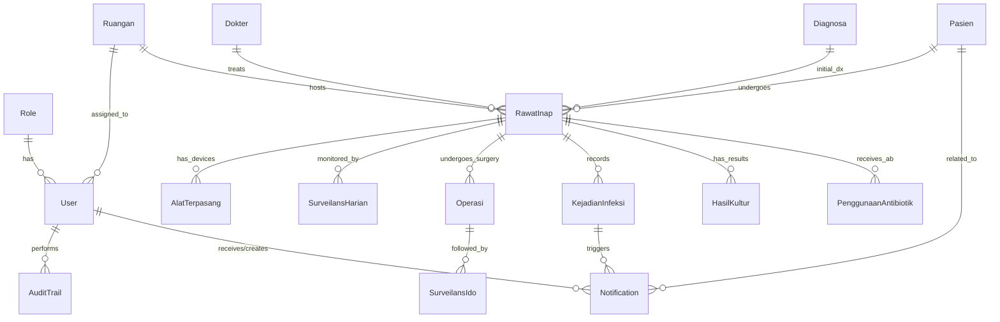

# Dokumen Entity Relationship Diagram (ERD) Final
## Sistem Surveilans PPI - RSU Budi Rahayu

Dokumen ini merinci struktur database final yang digunakan dalam Sistem Surveilans Pencegahan dan Pengendalian Infeksi (PPI) RSU Budi Rahayu.

### 1. Diagram Logis (Mermaid)

### 2. Definisi Entitas Utama

| Entitas | Deskripsi |
|---------|-----------|
| **User & Role** | Mengelola autentikasi dan otorisasi (RBAC). Role terdiri dari ADMIN, IPCN, dan IPCLN. |
| **Pasien** | Data demografis dasar pasien (No RM, Nama, Tgl Lahir, Alamat). |
| **Ruangan** | Master data unit/bangsal perawatan (ICU, Melati, Mawar, dll). |
| **RawatInap** | Entitas transaksi utama yang menghubungkan Pasien, Ruangan, Dokter, dan Diagnosa (Admission). |
| **AlatTerpasang** | Tracking pemasangan alat medis (Vena Sentral, Kateter Urine, Ventilator, dll) untuk perhitungan Device Day. |
| **SurveilansHarian** | Log pemantauan harian pasien (suhu, status alat, tanda infeksi). |
| **KejadianInfeksi** | Pencatatan kasus infeksi (HAIs) seperti ISK, IADP, VAP, PLEBITIS, dll. |
| **AuditTrail** | Log aktivitas sistem untuk keamanan dan integritas data (Who, What, When, Where). |
| **Notification** | Sistem pemberitahuan real-time untuk alert alat medis dan kasus infeksi baru. |

### 3. Integritas Data
- **Foreign Key Constraints**: Semua relasi menggunakan referensi kunci utama untuk memastikan konsistensi data.
- **Unique Constraints**: Email user, Kode Ruangan, Kode Diagnosa, dan No RM Pasien bersifat unik.
- **Indexes**: Diimplementasikan pada kolom pencarian utama (email, no_rm, tanggal) untuk optimasi performa.

---
*Generated: 2026-06-10 | Versi 1.0 Final*
